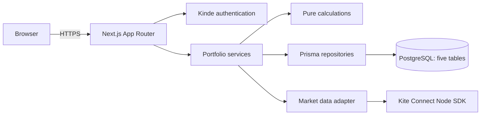

# Personal Portfolio Tracker — Technical Specification

Status: revised proposal, 2 November 2026. This supersedes the previous household design. Related: [product plan](../tasks/plan.md) and [delivery checklist](../tasks/todo.md).

## 1. Scope and decisions

Each Kinde login owns one independent investment portfolio. A user manually records executed purchases, sales and other cash flows, or imports them from CSV. Kite is a market-data provider: given a supported exchange and ticker, retrieve the latest price and daily historical prices. Do not fetch brokerage holdings, place orders, model broker accounts or use WebSockets. EPF, fixed deposits and other debt are manually valued. Mutual funds and physical gold start with manual valuations; listed ETFs can use Kite where supported.

Other logins are isolated, not members of a shared household. Initial deployment is Vercel with managed Postgres; domain logic, persistence and market-data adapters must be portable to another host. Target five core tables and compute holdings rather than persisting extra models. This favors simplicity for a personal portfolio; scale-driven caches, workers and audit tables can be introduced later when supported by evidence.

## 2. Architecture



Use TypeScript strict mode, Next.js App Router and Node runtime, Prisma ORM and Prisma Client with PostgreSQL, lucide-react for icons, Kinde SDK, official Kite SDK, Zod boundary schemas, a decimal arithmetic library, accessible UI primitives and a chart library. Keep route handlers and server actions thin. Services perform authorization and coordinate transactions, a pure domain module calculates returns, and repository/provider adapters isolate Prisma and Kite. Create Prisma Client once per warm process; configure a provider-compatible pooled runtime connection and a direct migration connection where required. See [Prisma connections](https://docs.prisma.io/docs/orm/prisma-client/setup-and-configuration/databases-connections). Use the Prisma CLI and Prisma Migrate for schema migrations and Prisma Client for application database queries. Pin compatible dependency versions during implementation rather than embedding stale version assumptions. Use lucide-react consistently for interface icons with accessible labels where needed.

Suggested directories: `src/app` routes, `src/features` screens and application services, `src/domain` calculation functions, `src/server/db` Prisma repositories, `src/server/market-data` adapters, `prisma` schema/migrations, and `tests` for unit, integration and end-to-end verification. No domain module depends on Next.js or SDK response types.

## 3. Five-table data model

Identifiers are UUIDs, timestamps UTC `timestamptz`, financial dates Postgres `date`. Money and prices use `numeric(24,8)` and quantities `numeric(28,10)`; use decimal arithmetic end-to-end and serialize decimals as strings. Currency INR initially. Use foreign keys, database checks and indexed access; add SQL migrations for constraints Prisma cannot express.

### `User`

`id`, unique `kindeSubject`, optional display name, created/updated timestamps. Every user-owned query is scoped using the authenticated Kinde subject resolved server-side. One user corresponds to one portfolio; a distinct portfolio table is unnecessary.

### `Instrument`

`id`, `ownerUserId` nullable, `assetType` (STOCK, MUTUAL_FUND, GOLD, DEBT_OTHER), `name`, `exchange` nullable, `tradingSymbol` nullable, `providerToken` nullable, `isin` nullable, `unit` (share, unit, gram or account), `currency`, `isActive`, `lastSyncedAt`, and optional JSON metadata (e.g. maturity date, purity). Shared Kite catalog entries have null `ownerUserId`; custom manual assets have an owner. Use a partial unique index on `(exchange, tradingSymbol)` for active shared listings, and an index on `ownerUserId`. Stable internal IDs anchor transactions; provider token is a refreshable mapping, not the primary key. Sync updates or marks unavailable; never delete instruments referenced by transactions. Preserve mapping changes where necessary, and flag ambiguous symbol changes for manual resolution. Access to custom instruments requires matching ownership.

### `Transaction`

`id`, `userId`, `instrumentId`, `type` (BUY, SELL, INCOME, FEE, ADJUSTMENT), `date`, `sequence`, `quantity` nullable, `unitPrice` nullable, `amount` nullable, `fees`, `taxes`, `currency`, `externalReference` nullable, `source` (MANUAL or CSV), `notes` nullable, `version`, `voidedAt` nullable, `createdAt`, `updatedAt`. All amounts have nonnegative magnitudes; type defines direction. BUY/SELL require positive quantity and nonnegative price; income/fee requires amount. Adjustment semantics must explicitly define unit and cost impact; unsupported corporate actions are flagged. Order same-day events by `(date, sequence, id)`. Add index `(userId, instrumentId, date, sequence, id)` and partial unique `(userId, externalReference)` for active non-null references. A manual asset can be referenced only by its owner; enforce through scoped service checks and, where feasible, database constraints. Edits use optimistic `version`; void rather than hard-delete. In this lean v1, version and timestamps do not provide a full revision audit trail; add an audit table if immutable history becomes a requirement.

### `PriceObservation`

`id`, `instrumentId`, nullable `userId`, `source` (KITE or MANUAL), `observedAt`, `marketDate`, `interval` (QUOTE or DAY or MANUAL), `price`, optional OHLC fields, `adjustmentBasis`, `retrievedAt`. Kite observations have null user only if sharing market data under applicable provider terms is confirmed; otherwise scope them to the authorized user. Manual valuations must have `userId` and apply only to their owner. Index `(instrumentId, userId, marketDate)` and use uniqueness/upsert rules for source, scope, instrument, interval and observation date; implement separate partial unique indexes for null and non-null user scope. A manual valuation stores the value per unit and unit explicitly; account-like EPF/FD can use quantity 1 and a total account value, provided contributions and redemptions use compatible units. Confirm the precise manual-entry representation in UI and fixtures before implementation. Historical daily prices are close values; quote timestamps and manual effective dates remain distinct.

Prisma illustration, deliberately not the entire schema or complete security model:

```prisma
model Transaction {
  id           String   @id @default(uuid()) @db.Uuid
  userId       String   @db.Uuid
  instrumentId String   @db.Uuid
  type         String
  date         DateTime @db.Date
  sequence     Int
  quantity     Decimal? @db.Decimal(28, 10)
  unitPrice    Decimal? @db.Decimal(24, 8)
  amount       Decimal? @db.Decimal(24, 8)
  fees         Decimal  @default(0) @db.Decimal(24, 8)
  taxes        Decimal  @default(0) @db.Decimal(24, 8)
  version      Int      @default(1)
  voidedAt     DateTime? @db.Timestamptz(6)
  @@index([userId, instrumentId, date, sequence, id])
}
```

The actual schema must add relationships, ownership checks, event validation, references and indexes described above. Avoid cascade deletion of shared instruments. Account deletion removes user-owned rows and user-scoped observations; shared catalog and authorized shared market prices remain independent of individual portfolios.

## 4. Security and Kite session

Kinde and Kite sessions are separate. Kinde verifies the app user; Kite's [login flow](https://kite.trade/docs/connect/v3/user/) provides a broker access token for entitled market API calls, even though holdings are not fetched. The documented token expires the next morning or may be invalidated earlier. Credential ownership is an open decision: for a personal deployment, configure the app key/secret server-side and obtain an explicitly authorized session; determine whether multiple independent app logins can use it under Kite's terms. Never silently use one user's Kite session or market data for another unless authorization and provider terms permit it.

Store an encrypted token and expiry as nullable columns on `User` for per-user sessions, or in a server-side secret store if a single-owner deployment is chosen; do not add a separate broker table now. Encrypt with a managed key, bind login callback to a short-lived single-use state and authenticated user, avoid passwords/TOTP storage and redact credentials from logs. Clear token on disconnect. When expired, show last cached data with timestamps and prompt reconnect. Each server action and route verifies session and user ownership, including custom instruments, transactions, CSV and manual prices. Treat server actions as public endpoints per [Next.js guidance](https://nextjs.org/docs/app/guides/authentication). Never authorize using a user ID supplied by the browser.

## 5. Market-data flow

1. User adds or finds a ticker using the synced Kite instrument master. The dump is refreshed periodically when an authorized session is present; Kite recommends daily refresh and `exchange + tradingsymbol` as the lookup key. [Kite instruments](https://kite.trade/docs/connect/v3/market-quotes/).
2. On dashboard or details request, load user transactions and cached observations. Return usable cached data quickly; fetch stale/missing quotes and necessary daily history on demand within bounded server execution. Update UI with results; do not require a background worker or WebSocket.
3. Batch quote requests where supported, use conservative bounded concurrency and backoff on 429. Kite documents [quote 1 request/second and historical 3 requests/second](https://kite.trade/docs/connect/v3/exceptions/); exact rate-limit scope and enforcement must be verified. In a serverless deployment, per-instance memory is not a global limiter: coordinate across instances using a Postgres transaction/locking mechanism or a managed distributed limiter, with no assumption that a local throttle suffices. Do not keep a database lock open across network calls. If unable to obtain a rate slot quickly, return cache and a retryable state.
4. Upsert retrieved observations idempotently. Query only missing windows, respecting provider date range limits, and bound amount of history fetched per request; show partial coverage when more history is needed. Quote falls back to most recent available daily close, clearly dated. If history or token is unavailable, retain prior cache and show unavailable/stale status. No fake prices or interpolation.
5. Verify corporate-action adjustment behavior and historical entitlement with Kite before production. Split or symbol changes can invalidate return calculations; explicitly report incomplete data when consistency cannot be established.

No automatic freshness is guaranteed while the app is closed. A future scheduled worker can call the same adapter and service if required; Vercel functions should not host a persistent WebSocket.

## 6. Ledger and calculations

Compute holdings from active transactions ordered by date/sequence. FIFO cost allocation is calculated per user and instrument; persist sale-to-buy allocations as described below. Buy fees are included in cost; sale fees and taxes reduce proceeds. Remaining cost = sum of unsold lot costs; value = quantity × applicable price; unrealized P/L = value − remaining cost. Realized P/L = net sale proceeds less allocated cost. Income is shown separately. Use database transactions and a per-user/instrument transaction-scoped lock to serialize edits and imports. Replay all affected events including later sales before commit; reject oversells, including those caused by backdated edits. On concurrency conflicts retry safely. This lock must work with the chosen connection pool and never span a provider call.

Single-lot CAGR = `(endingValue / startingCost)^(365 / elapsedDays) - 1` when inputs and dates are valid. XIRR uses negative purchase cash flows and fees, positive sale proceeds and income, plus current holding value on valuation date. Collapse same-day cash flows; flag invalid, nonconvergent or ambiguous multiple-root cases. Never average XIRRs across assets. Value manual assets only at user-entered as-of values; income and contributions must be entered to compute a meaningful XIRR.

For 7/15/30/60/90 days use calendar days, and for six months/one year calendar arithmetic, in Asia/Kolkata. Baseline is the most recent available observation on or before the target date; return actual dates. Display market price movement separately from personal gain. Personal P/L for a period = ending value − starting value − net contributions + distributions, where net contributions include buys and fees less net sale proceeds. A time-weighted percentage requires valuations at flow boundaries; if insufficient, return unavailable, not a misleading approximation. On dates before first investment use the first transaction date and label the shortened period. Portfolio value charts reconstruct quantities at each point from ledger and price history; mark incomplete when any material position has no price. For manual assets, no values before first observation and no claim of live valuation; label carried-forward values with their as-of date and omit or flag gaps according to the chart's coverage policy.

## 7. Minimal server interfaces

Use server actions for mutations and server-side reads where appropriate; route handlers only where useful for client refresh, CSV download or Kite callback. All endpoints/actions require authenticated user except the state-verified callback. This is a logical interface, not a mandate to create a route for each line:

- `searchInstruments(query, assetType)` and `listInvestments(assetType)`.
- `getDashboard(range)` and `getInvestmentDetail(instrumentId, range)`: return dated price, P/L, calculation method and coverage; no cross-user data.
- `saveTransaction(input, expectedVersion?)`, `voidTransaction(id, expectedVersion)` and `saveManualValuation(input)`.
- `previewCsv(file)` and `commitCsv(normalizedRows, idempotencyKey)`, plus CSV template download.
- `connectKite`, callback and `disconnectKite`.

Use Zod validation at boundaries; decimal strings and ISO dates in responses. Error shape `{code, message, fieldErrors?}` with consistent 401, 403/404, 409, 422, 429 and provider-unavailable semantics. Cursor pagination for potentially large lists. All queries are user-scoped server-side.

## 8. CSV without extra tables

Provide a versioned UTF-8 template with `asset_type,transaction_type,transaction_date,exchange,symbol,asset_name,unit,quantity,unit_price,amount,fees,taxes,currency,external_reference,notes`. Fields are conditional: listed stocks need exchange/symbol; manual assets need name/unit; buys/sells need quantity and price; income/fees need amount. Preview parses, validates and resolves instruments without database writes; display row errors and likely duplicates. Limit bytes and rows. On confirmation, submit normalized rows with an idempotency key. Without an import-batch table, enforce idempotency by storing an import key and source row number on each transaction, with unique `(userId, importKey, sourceRowNumber)`; store a hash of the normalized batch and reject reuse of a key with different contents. For an all-or-nothing import, check the existing rows and batch hash in the same database transaction, serialize requests for that user's import key, lock affected instrument positions in deterministic order, revalidate chronology, and insert all or none. Retrying the same key returns the existing outcome. An external reference also gets a scoped unique constraint. A separate import table is a future option if durable previews, partial commits or richer history become necessary. Escape formula-triggering cells on CSV export.

## 9. UX, operations and verification

Dashboard and tabbed investments show values, cost, P/L and freshness; detail shows individual transactions, chart, requested ranges, CAGR/XIRR and calculation explanations. Debt & Other holds manual EPF, FD and debt entries. Provide responsive layout, keyboard interaction, text alternatives, reduced motion and explicit no-data, stale, loading and reconnect states. Display a manual valuation's date prominently.

Deploy on Vercel with a Marketplace Postgres provider, isolated production/preview databases, Kinde and Kite credentials, pooled application connections and direct migration connection as needed. Run reviewed `prisma migrate deploy` as a controlled deployment step; use versioned expand/contract migrations. Use a secrets manager, backups and restoration drills; log request IDs and error categories, not tokens or transaction payloads. Keep all business logic provider-independent for migration off Vercel.

Test unit fixtures for FIFO partial sales, fees, XIRR edge cases, cash-flow-adjusted periods and calendar boundaries. Integration tests cover two-user isolation, custom instrument access, concurrent oversells, import rollback/idempotency, manual valuation scope, token expiry and 429 behavior. E2E covers sign-in, manual purchase, CSV import, ticker lookup, detail periods and stale data. Validate charts and returns against independently calculated fixtures and exercise accessible mobile flows. Test backup restoration and provider error recovery before release.

## 10. Open decisions

- Kite key/session arrangement for multiple independent Kinde users, price-sharing rights, costs and historical-data entitlement.
- Corporate-action and symbol-change behavior in the selected Kite data series.
- Exact representation of EPF and fixed deposit contributions versus a whole-account valuation; support correct XIRR without treating deposits as extra account units.
- Cache TTL, historical depth, import limits and refresh behavior after a small-scale provider proof of concept.
- Whether fuller transaction revision history is required; the lean model only retains current version, timestamps and void status.


## 11. Sold lots and tax reporting extension

### Persistence and transaction contract

Add `SaleAllocation` as the fifth core table: `id`, `userId`, `instrumentId`, `saleTransactionId`, `buyTransactionId`, `quantity`, `buyDate`, `saleDate`, `buyUnitPrice`, `saleUnitPrice`, allocated acquisition charges and sale charges (itemized where relevant), `investmentCost`, `netProceeds`, `realizedInvestmentPnl`, optional `taxCost`, `taxableGain`, `taxClassification`, `reviewStatus`, `calculationVersion`, `createdAt`, `updatedAt`. Monetary values use the same decimal precision as the ledger. Buy and sell foreign keys reference user-owned active events; unique `(saleTransactionId,buyTransactionId)`; index `(userId,saleDate,id)` and `(userId,instrumentId,saleDate)`. Persist these as a rebuildable projection of the canonical BUY/SELL ledger, with a version, not an independent source of truth. CAGR/XIRR are calculated from matched lot cash flows and returned in the view (optionally cached with calculation version), unavailable for zero-day/invalid inputs; they are investment metrics, not tax figures. If dividends or other cash flows are not reliably attributable to a sold lot, label lot XIRR as excluding them and expose that limitation. Financial P/L and taxable gain are separate values.

For a sell: authorize user, lock affected user/instrument/tax-pool key, replay buys and sells in chronological order, reject oversell, insert SELL and allocation rows, update or recompute affected later allocations, and commit atomically. Readers see either the old or new complete state; refresh/invalidate holdings and Sold view after commit and retrieve on reload. Multiple purchases matched to one sale yield multiple allocation rows. Corrections to backdated buys/sells and voids trigger a complete replay from the affected point in the same transaction for bounded personal data; reject corrections that invalidate a later sale. Test concurrent sells, retries, pagination and deterministic ordering. Add an optional `taxLotPool` string to transactions (default UNKNOWN); FIFO for tax is per demat account, and a shared unknown pool cannot guarantee legal matching across multiple demat accounts. Require an explicit pool for tax-ready classification; portfolio-level aggregate can remain broker-independent. Confirm whether the user actually holds a ticker in multiple demat accounts. [Statutory FIFO provision](https://www.incometaxindia.gov.in/w/section-45-55).

### Tax data and classification

Capture separate acquisition and sale brokerage, other eligible charges, and STT rather than a single opaque fee; STT is not deductible for capital-gains computation. Store trade/contract dates, ISIN, instrument type, exchange, transaction reference, STT applicability, acquisition and disposal quantities and dates, and optional 31 January 2018 FMV and source for potentially grandfathered 112A assets. Treat grandfathering, transfers, splits, bonus issues, inherited assets, non-resident rules and incomplete cost histories as review-required unless explicitly implemented and verified. Source values come from user records, not Kite. Do not silently classify a trade merely from ticker: STT applicability and asset eligibility must be supplied/confirmed. Use assessment-year-versioned rules and effective dates for holding period, classification, grandfathering and tax-category mapping, with test fixtures and citations. Never reuse one year's ITR form mapping for another without checking the notified form. Where inputs/rules are missing, set tax values and classification to unavailable/review required; do not output an authoritative filing amount. Annual tax cost and gains can differ from financial P/L. See [Income Tax Department guidance](https://www.incometaxindia.gov.in/en/sale-of-shares).

### Reporting contract

A financial year runs 1 April–31 March and is followed by its assessment year. The notified AY 2026–27 form has five Schedule CG accrual windows: 1 Apr–15 Jun; 16 Jun–15 Sep; 16 Sep–15 Dec; 16 Dec–15 Mar; 16 Mar–31 Mar (inclusive). Map by actual sale date in local Indian calendar; store dates, not hard-coded quarter numbers. Boundary-test both days around every cutoff, leap years and FY change. Use a configurable, versioned reporting definition. [Notified form](https://www.incometax.gov.in/iec/foportal/sites/default/files/2026-04/Notification%20No.48_2026.pdf). For FY 2026–27 / AY 2027–28, do not assume the future form is identical: show provisional grouping pending its notification.

Sold view offers FY selection, grouped chronological sales, expandable matched lots, totals and cursor pagination. Annual report includes proceeds, financial and supported tax costs/gains, STCG/LTCG category when verified, losses, review counts, actual dates and per-period breakdown, with CSV export. Schedule CG accrual lines may require values after current-year and brought-forward loss adjustments, and other information outside this app; raw period totals are NOT a substitute for those entries. Support explicit reconciliation with broker tax P&L, contract notes and applicable ITR instructions; label report as preparation data rather than filing-ready until those adjustments are modeled. Do not claim this produces final tax, advance-tax liability, ITR form choice or a ready-to-file return; additional income, losses, exemptions, credits and taxpayer status affect them. The ITR-2 manual describes [Schedule CG and 112A](https://www.incometax.gov.in/iec/foportal/help/FileITR-2Online), and its [AY 2026–27 FAQ](https://www.incometax.gov.in/iec/foportal/help/all-topics/e-filing-services/itr-2/itr-2-faqs?mobile-app=1) confirms forms can change annually.
